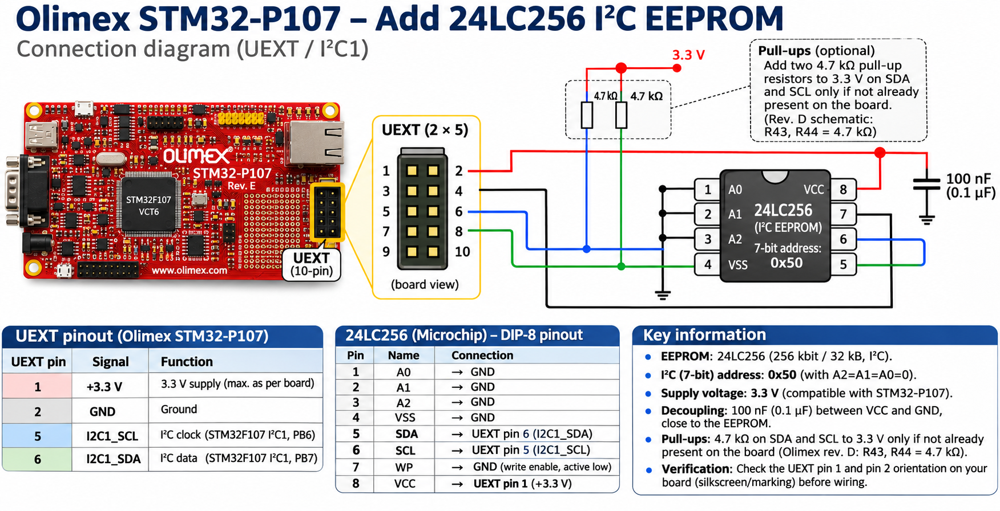
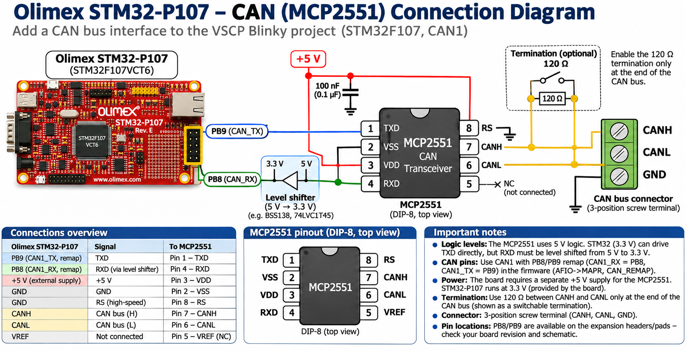
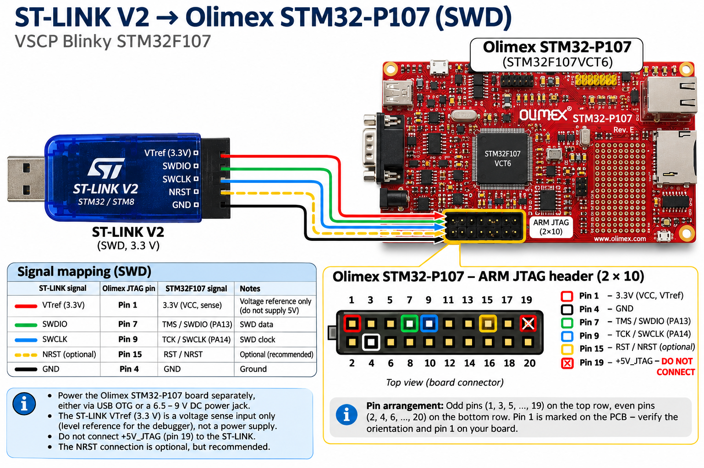

# vscp-demo-olimex-stm32-P107-blinky

The [VSCP](https://www.vscp.org) Blinky demo node on the [Olimex STM32-P107](https://www.olimex.com/Products/ARM/ST/STM32-P107/) (STM32F107VC with 100 Mbit Ethernet), all board revisions. It has an LED that can be turned on and off or blink, a button that sends events, a millisecond counter and a decision matrix, as described in the [Blinky documentation](https://github.com/grodansparadis/vscp/wiki/Blinky-Documentation) and the [Blinky MDF](https://eurosource.se/blinky0.json). The registers are saved in a 24LC256 EEPROM.

The transports are selected in [main/vscp-projdefs.h](main/vscp-projdefs.h) and run at the same time:

| Transport | Setting | Default | VSCP |
| --- | --- | --- | --- |
| VSCP link protocol (TCP/IP) | `BLINKY_ENABLE_LINK` | On. Port 9598, user `vscp`, password `secret`, up to 3 clients | [Text protocol](https://grodansparadis.github.io/vscp-doc-spec/#/./vscp_tcpiplink): login, `send`, `retr`, `rcvloop`, filters, ... |
| UDP | `BLINKY_ENABLE_UDP` | On. Port 33333, events sent to 255.255.255.255 (broadcast) | [VSCP frames](https://grodansparadis.github.io/vscp-doc-spec/#/./vscp_over_udp), one per datagram, not encrypted |
| Multicast | `BLINKY_ENABLE_MULTICAST` | On. Group 224.0.23.158, port 44444 | [VSCP frames](https://grodansparadis.github.io/vscp-doc-spec/#/./vscp_multicast) on the VSCP multicast group |
| MQTT | `BLINKY_ENABLE_MQTT` | Off; set the broker | [VSCP JSON events](https://grodansparadis.github.io/vscp-doc-spec/#/./vscp_over_mqtt), published on `vscp/{guid}/{class}/{type}`, received on `vscp/{guid}/in` |
| CAN4VSCP gateway | `BLINKY_ENABLE_CAN` | On. 125 kbit/s | [VSCP Level I events on CAN](https://grodansparadis.github.io/vscp-doc-spec/#/./vscp_over_can), between the CAN bus and the IP transports (see below) |

Events received over any of them are handled by the node (register read/write and the other protocol events) and run through the decision matrix. Events from the node are sent over all of them.

## Hardware

| | | |
| --- | --- | --- |
| MCU | STM32F107VCT6 | 72 MHz from the 25 MHz crystal (PLL2, PLL), 256 KB flash, 64 KB RAM |
| Ethernet | LAN8710A (revision E) or Micrel KS8721 (older revisions) PHY, RMII | The 50 MHz reference clock comes from MCO (PA8, PLL3). The PHY and its address are found at start (`BLINKY_PHY`) |
| LED | STAT1 (green), PC6 | The Blinky LED |
| LED | STAT2 (yellow), PC7 | Network: blinks without an IP address, on with one |
| Button | WKUP, PA0 | The Blinky button (pressed = high) |
| EEPROM | 24LC256 on I2C1, PB8 SCL / PB9 SDA (remapped) | Saved registers. Any address 0x50-0x57 |
| Log | RS232 connector (USART2, PD5/PD6 remapped) | 115200 8N1. Use an RS232-level adapter; a TTL-level USB serial adapter gives garbage |
| CAN | Transceiver on PD0 RX / PD1 TX (CAN1, remapped) | The CAN4VSCP gateway |
| Debug | 20 pin JTAG connector | ULINK-ME, or any JTAG/SWD probe that OpenOCD supports |

The node also works without an Ethernet link (LED, button, counter, saved registers). The Ethernet MAC is set up at start without waiting for a link; when the link comes up, auto-negotiation is done and the network is started.

To add EEPROM use the I2C interface and connect a 24LC256 device to PB8 (SCL) and PB9 (SDA). The address pins A0-A2 can be set to any address (0x50-0x57); the firmware finds the EEPROM when it starts.



To add CAN support, connect a CAN transceiver to PD0 (RX) and PD1 (TX) and make sure CAN is on in the firmware (`BLINKY_ENABLE_CAN`, or `BLINKY_CAN_NODE` for a CAN node only) with the bit rate of the bus (`BLINKY_CAN_BITRATE`).



## Build and flash

Install an ARM GCC toolchain (`gcc-arm-none-eabi`, `libnewlib-arm-none-eabi`) and CMake. The STM32F1 HAL and CMSIS files from ST, lwIP 2.1.3, vscp-firmware and cJSON are fetched when the project is configured.

```bash
git clone https://github.com/grodansparadis/vscp-demo-olimex-stm32-P107-blinky.git
cd vscp-demo-olimex-stm32-P107-blinky
cmake -B build
cmake --build build -j4
```

This gives `build/vscp-blinky.elf`, `.bin` and `.hex`. Flash with OpenOCD over JTAG, for example with a Keil ULINK-ME (with CMSIS-DAP firmware; OpenOCD needs the HID backend):

```bash
openocd -c "adapter driver cmsis-dap" -c "cmsis_dap_vid_pid 0xc251 0x2721" -c "cmsis_dap_backend hid" \
  -c "transport select jtag" -f target/stm32f1x.cfg \
  -c "program build/vscp-blinky.elf verify reset exit"
```

or with an ST-LINK on the JTAG connector (SWD: SWDIO pin 7, SWCLK pin 9, GND pin 4, NRST pin 15, VTref pin 1):




```bash
openocd -f interface/stlink.cfg -f target/stm32f1x.cfg -c "program build/vscp-blinky.elf verify reset exit"
```

A Keil ULINK-ME must have CMSIS-DAP firmware to work with OpenOCD (with the original Keil firmware it does not answer CMSIS-DAP commands).

The board can also be flashed without a debugger over the RS232 port with the STM32 serial boot loader (jumpers RST_E and BOOT0_E, see the board manual) and `stm32flash -w build/vscp-blinky.bin -v /dev/ttyUSB0`.

### Settings

All settings are in [main/vscp-projdefs.h](main/vscp-projdefs.h). Each can also be set without editing the file, with `-DBLINKY_DEFINES="..."` or in `blinky_local.cmake` (not committed, see [blinky_local.cmake.example](blinky_local.cmake.example)):

```bash
cmake -B build "-DBLINKY_DEFINES=BLINKY_ENABLE_MQTT=1;BLINKY_MQTT_BROKER=\"192.168.1.9\""
```

| Setting | Default | |
| --- | --- | --- |
| `BLINKY_CAN_NODE` | 0 | 1 = build a CAN4VSCP node only (see below) |
| `BLINKY_ENABLE_LINK`, `_UDP`, `_MULTICAST`, `_MQTT` | 1, 1, 1, 0 | Transports |
| `BLINKY_ENABLE_CAN` | 1 | CAN4VSCP gateway |
| `BLINKY_CAN_BITRATE` | 125000 | 125000 (the CAN4VSCP standard), 250000, 500000 or 1000000. 87.5 % sample point |
| `BLINKY_CAN_LOOPBACK` | 0 | Test mode: the CAN controller gets its own frames and sends nothing on the bus |
| `BLINKY_PHY` | `BLINKY_PHY_AUTO` | Ethernet PHY: `BLINKY_PHY_LAN8710A` (revision E), `BLINKY_PHY_KS8721` (older revisions) or `BLINKY_PHY_AUTO` (finds either). The log says so if the PHY found is not the one selected |
| `BLINKY_IP` | "" | Static IPv4 address; empty = DHCP. Also `BLINKY_NETMASK`, `BLINKY_GATEWAY` |
| `BLINKY_LINK_PORT` | 9598 | |
| `BLINKY_LINK_MAX_CLIENTS` | 3 | |
| `BLINKY_LINK_USER`, `BLINKY_LINK_PASSWORD` | vscp, secret | |
| `BLINKY_UDP_PORT` | 33333 | |
| `BLINKY_UDP_REMOTE_HOST` | 255.255.255.255 | Events are sent here |
| `BLINKY_MULTICAST_GROUP`, `_PORT`, `_TTL` | 224.0.23.158, 44444, 1 | |
| `BLINKY_MQTT_BROKER`, `_PORT` | 192.168.1.9, 1883 | Broker IPv4 address. Also `_USER`, `_PASSWORD`, `_PUBLISH_TOPIC`, `_SUBSCRIBE_TOPIC` |
| `BLINKY_SNTP_SERVER` | 216.239.35.0 | SNTP server IPv4 address (time.google.com); empty = off |
| `BLINKY_LED_ACTIVE_HIGH`, `BLINKY_BUTTON_PRESSED_HIGH` | 1, 1 | LED and button polarity (board.h) |

The RS232 port shows what the node does:

```
VSCP Blinky demo for the Olimex STM32-P107 0.1.0
Transports: link udp multicast
MAC 02:5A:31:7C:0E:94
EEPROM: 24LC256 at 0x50
Ethernet: KS8721 PHY (id 0022:1619) at address 1
Ethernet link up, 100 Mbit/s full duplex
DHCP: asking for an address
IP address 192.168.1.70
VSCP link protocol server on port 9598 (3 clients)
UDP: port 33333, events to 255.255.255.255
Multicast: group 224.0.23.158 port 44444
CAN4VSCP gateway: 125000 bit/s on PD0/PD1
SNTP: time set
```

## CAN4VSCP gateway

The board connects a [CAN4VSCP](https://grodansparadis.github.io/vscp-doc-spec/#/./vscp_over_can) bus (VSCP Level I events on CAN, 29-bit identifier: priority, class, type and the nickname of the sender) with the IP transports:

| Direction | What |
| --- | --- |
| CAN → IP | Every frame on the bus is sent as a VSCP event over all IP transports (link protocol clients, UDP, multicast, MQTT). Its GUID is the interface GUID: the GUID of the node with the nickname of the CAN node in the last byte (`FF:FF:FF:FF:FF:FF:FF:FE:<MAC>:00:<nickname>`). The events are also given to the Blinky node, so its decision matrix can react to buttons on the bus |
| IP → CAN | Level I events (class 0-511) received from the IP transports are sent on the bus. Level I events over Level II (class 512-1023, the GUID of the destination in data bytes 0-15) are sent without the GUID, so a client can read and write the registers of the nodes on the bus |
| Node → CAN | The Level I events of the Blinky node (ON, OFF, button events, register read/write answers) are also sent on the bus, with its nickname (register 0x91, default 0x10). It is a node on the CAN segment too |

Frames that came from the bus are never sent back on it. The link protocol `interface list` command shows the bus as interface 1.

Connect CAN_H, CAN_L and GND of the board's CAN connector to the bus; the bus needs 120 Ω between CAN_H and CAN_L at both ends. Without other nodes on the bus the frames are not acknowledged and are dropped.

To test the gateway without a bus, build with `BLINKY_CAN_LOOPBACK=1`: the CAN controller then receives its own frames (as from nickname 0x10) and sends nothing. `tools/blinky_test.py --host <ip> canloop` checks node events, client events and Level I over Level II events through CAN and back. In this test mode the node's own answers also come back from "CAN", so run the other tests with a normal build.

## CAN4VSCP node only

With `BLINKY_CAN_NODE 1` in `vscp-projdefs.h` (or `-DBLINKY_DEFINES=BLINKY_CAN_NODE=1`) the board is built as a plain CAN4VSCP node: no Ethernet, no lwIP, no IP transports (about 40 KB flash, 28 KB RAM). The Blinky functionality, the decision matrix and the EEPROM are the same.

- It is a Level I node: standard registers at 0x80-0xFF, user registers 0x00-0x7F (decision matrix at 0x60), the heartbeat is CLASS1.INFORMATION node heartbeat (20/9), as in the MDF
- Nickname discovery: with no nickname (0xFF) it probes the bus when it starts and takes the first free nickname, which is kept in the EEPROM. Write 0xFF to register 0x91 and restart to find a new one
- STAT2 blinks while the node looks for a nickname and is on when it has one
- The time in the events is the time since the start (no clock)

`BLINKY_CAN_LOOPBACK 1` also works here: with no other node answering, the node takes nickname 1.

## The node

### GUID

The STM32F107 has no MAC address of its own. A locally administered address is made from the unique id of the chip (`02:xx:xx:xx:xx:xx`), and the GUID from that: `FF:FF:FF:FF:FF:FF:FF:FE:<MAC>:00:00` ([Ethernet/MAC address based GUID](https://grodansparadis.github.io/vscp-doc-spec/#/./vscp_globally_unique_identifiers)). Get it with `ggid` over the link protocol.

### Registers

| Register (page 0) | Use |
| --- | --- |
| 0, 1 | Zone and subzone of the node [saved] |
| 2 | Status: bit 1 LED on, bit 0 button pressed. Writing bit 1 turns the LED on/off (when the LED is enabled) |
| 3 | Control [saved, default 0xCE]: bit 7 LED enabled, bit 6 button enabled, bit 3 send TURN-ON on press and TURN-OFF on release, bit 2 send START on press, bit 1 send STOP on release, bit 0 millisecond counter running |
| 4, 5 | Blink interval in ms, MSB first [saved, default 500]. Zero stops blinking |
| 6-9 | Millisecond counter, MSB first. Writing any of them clears it. When it wraps, alarm bit 7 is set |
| 10-12 | Byte 0, zone and subzone of the button events [saved] |
| 0x60-0x7F | Decision matrix: four Level I rows of eight bytes (origin, flags, class mask, class filter, type mask, type filter, action, parameter) [saved] |

The standard registers are at 0xFFFFFF80 (Level II). The node is a Level II node, but it uses Level I decision matrix rows, as in the MDF, and it also answers CLASS1.PROTOCOL register read/write for nickname 0x10 (the default nickname, saved when it is changed).

Saved registers are written to the 24LC256 EEPROM one second after the last change, so a burst of writes is one save. Without the EEPROM the node works, but changes are lost at a restart.

### Decision matrix actions

| Action | |
| --- | --- |
| 0 | No operation |
| 1 | LED off/on/toggle (parameter 0/1/2) |
| 2 | LED on |
| 3 | LED off |
| 4 | Toggle the LED |
| 5 | Start blinking (interval in registers 4-5) |
| 6 | Stop blinking |
| 7 | Clear the millisecond counter |

The LED actions work when control bit 7 is set. On, off and toggle stop blinking.

### Decision matrix actions

| Action | |
| --- | --- |
| 0 | No operation |
| 1 | LED off/on/toggle (parameter 0/1/2) |
| 2 | LED on |
| 3 | LED off |
| 4 | Toggle the LED |
| 5 | Start blinking (interval in registers 4-5) |
| 6 | Stop blinking |
| 7 | Clear the millisecond counter |

The LED actions work when control bit 7 is set. On, off and toggle stop blinking.

### Events from the node

- CLASS1.INFORMATION ON/OFF (20/3, 20/4) when the LED is turned on or off by an action or a status register write (not for each blink). Data: index 0, zone, subzone
- CLASS1.CONTROL TURN-ON (30/5) when the button is pressed and TURN-OFF (30/6) when it is released (control bit 3). Data: registers 10-12
- CLASS1.INFORMATION START (20/25) on press and STOP (20/24) on release (control bits 2 and 1). Data: 0, button zone, button subzone
- CLASS2.INFORMATION node heartbeat (1026/2) and CLASS2.PROTOCOL capabilities (1024/20) every minute
- Responses to the protocol events (register read/write, who is there, ...)

The time in the events is the Unix time in nanoseconds from SNTP, or the time since the start until the time is set.


## Try it

### VSCP link protocol

```
$ telnet 192.168.1.70 9598
Welcome to the VSCP Olimex STM32-P107 Blinky demo node
...
+OK
user vscp
+OK - User name accepted, password please
pass secret
+OK - Ready to work.
send 0,0,9,0,,0,-,0x10,3
+OK - Success.
retr
0,0,10,0,...,FF:FF:FF:FF:FF:FF:FF:FE:02:5A:31:7C:0E:94:00:00,3,206
+OK - Success.
```

`send 0,0,9,...,0x10,3` reads register 3 (control) of node 0x10; the answer is CLASS1.PROTOCOL read/write response (0/10) with the register and its value (206 = 0xCE). `rcvloop` sends every event from the node as it comes. [VSCP Works](https://github.com/grodansparadis/vscp-works-qt) can be used with a tcp/ip connection to the node, and the MDF lets it show and set the registers by name.

### MQTT

Switch MQTT on and set the broker (`blinky_local.cmake`, or in `main/vscp-projdefs.h`):

```cmake
set(BLINKY_DEFINES "BLINKY_ENABLE_MQTT=1" "BLINKY_MQTT_BROKER=\"192.168.1.9\"" CACHE STRING "" FORCE)
```

Each event is published as one line of JSON, as made by the vscp-firmware helper. Events sent to the node can use those keys (`class`, `type`, `data`, ...) or the `vscpClass`, `vscpType`, `vscpData`, ... keys.

```bash
mosquitto_sub -h 192.168.1.9 -t 'vscp/#' -v
mosquitto_pub -h 192.168.1.9 -t 'vscp/FF:FF:FF:FF:FF:FF:FF:FE:02:5A:31:7C:0E:94:00:00/in' \
  -m '{"vscpHead":0,"vscpClass":0,"vscpType":9,"vscpData":[16,3]}'   # read register 3
```

When the broker can not be reached the node keeps working and tries again every five seconds.

### Test script

[tools/blinky_test.py](tools/blinky_test.py) tests a node over each transport (only the Python standard library; MQTT uses `mosquitto_pub`/`mosquitto_sub`):

```bash
tools/blinky_test.py --host 192.168.1.70 link
tools/blinky_test.py --host 192.168.1.70 udp
tools/blinky_test.py multicast
tools/blinky_test.py --host 192.168.1.70 --broker 192.168.1.9 mqtt
tools/blinky_test.py --host 192.168.1.70 --broker 192.168.1.9 all
tools/blinky_test.py --host 192.168.1.70 canloop    # build with BLINKY_CAN_LOOPBACK=1
```

## Layout

| | |
| --- | --- |
| `main/main.c` | MAC address and GUID, start, the main loop |
| `main/vscp-projdefs.h` | Transports and network settings |
| `main/board.c` | Clocks (72 MHz, 50 MHz PHY clock on MCO), LEDs, button, log port |
| `main/network.c` | lwIP, DHCP or static address, SNTP, network LED |
| `main/ethernetif.c` | lwIP Ethernet driver for the STM32F107 MAC and the LAN8710A or KS8721 PHY (RMII) |
| `main/blinky.c` | The node: Level II firmware callbacks, registers, LED, button, counter, decision matrix actions |
| `main/storage.c`, `main/eeprom.c` | Saved registers in the 24LC256 |
| `main/link_server.c` | VSCP link protocol server (lwIP raw TCP) |
| `main/udp_transport.c` | UDP and multicast (lwIP raw UDP, IGMP) |
| `main/mqtt_transport.c` | MQTT (lwIP MQTT client) |
| `main/can_gateway.c` | CAN4VSCP gateway (CAN1, HAL CAN) |
| `main/lwipopts.h` | lwIP settings (no RTOS, sized for 64 KB RAM) |
| `main/stm32f1xx_hal_conf.h` | HAL settings (LAN8710A PHY registers) |
| `tools/blinky_test.py` | Test script |

Everything runs in the main loop (lwIP without an RTOS). The VSCP code is from [vscp-firmware](https://github.com/grodansparadis/vscp-firmware) (helper, link protocol and Level II firmware), fetched by CMake at the commit in [CMakeLists.txt](CMakeLists.txt). Use `-DFETCHCONTENT_SOURCE_DIR_VSCP_FIRMWARE=<path>` to build with a local checkout.

## Other Blinky demos

See the [Blinky page](https://github.com/grodansparadis/vscp/wiki/Blinky) for the other implementations, for example [vscp-demo-link-stm32f401-wiz-ip20-blinky](https://github.com/grodansparadis/vscp-demo-link-stm32f401-wiz-ip20-blinky), [vscp-demo-esp32-wifi-blinky](https://github.com/grodansparadis/vscp-demo-esp32-wifi-blinky) and [vscp-demo-w55rp20-evb-pico-blinky](https://github.com/grodansparadis/vscp-demo-w55rp20-evb-pico-blinky).

## License

MIT, see [LICENSE](LICENSE). `main/ethernetif.c` is based on the STM32CubeF1 LwIP examples (BSD-3-Clause, STMicroelectronics).
